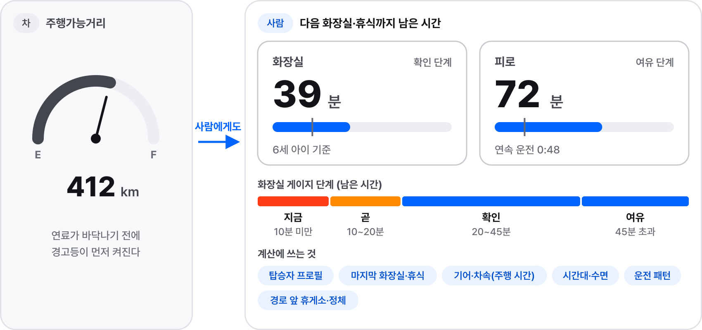
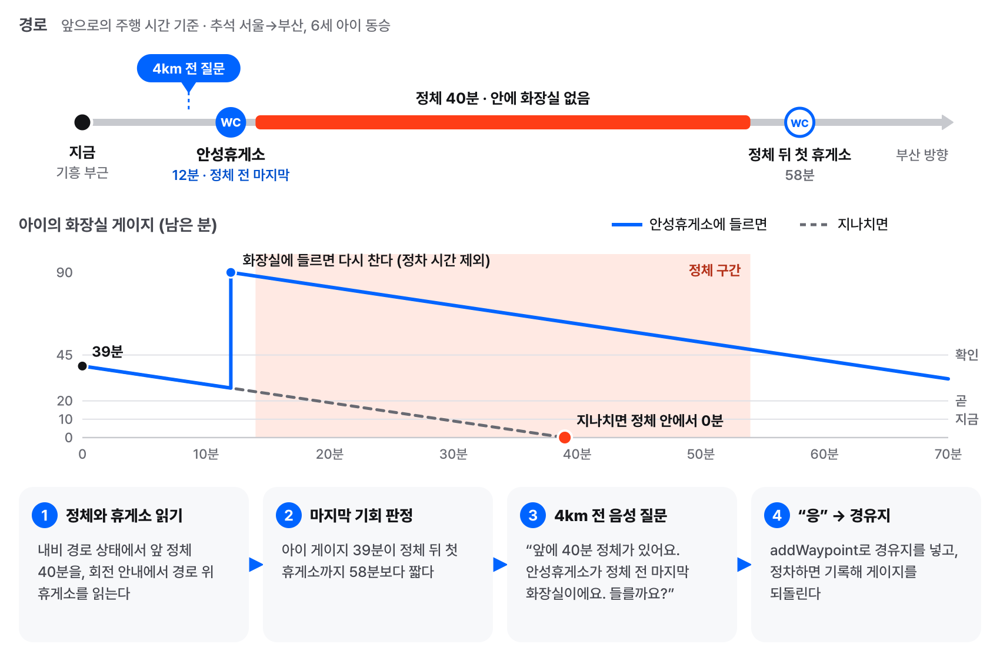
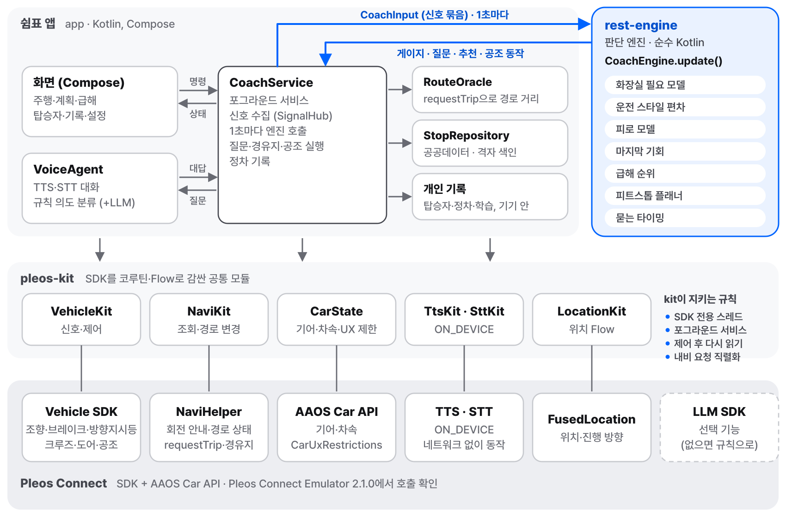
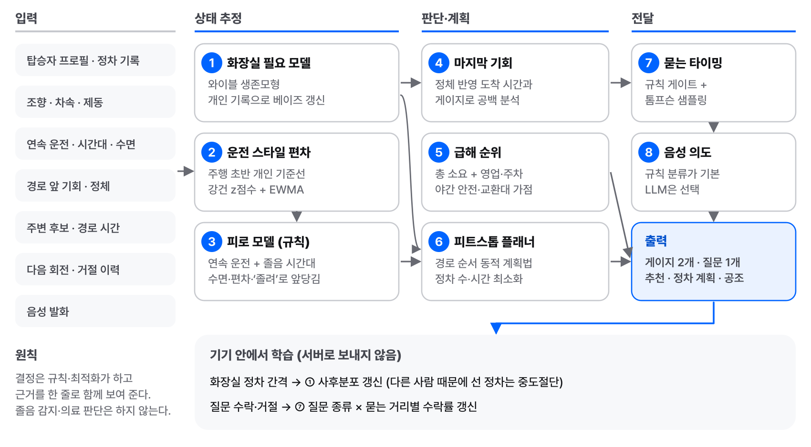
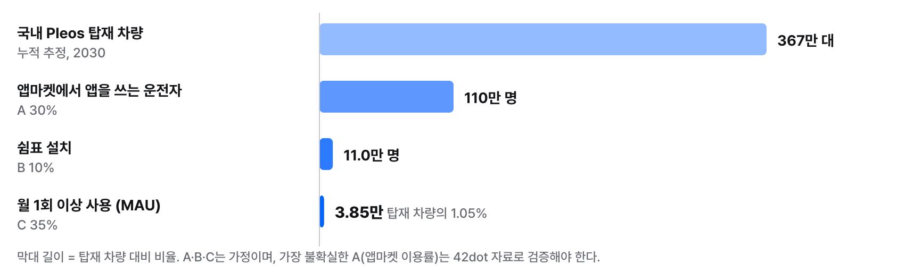
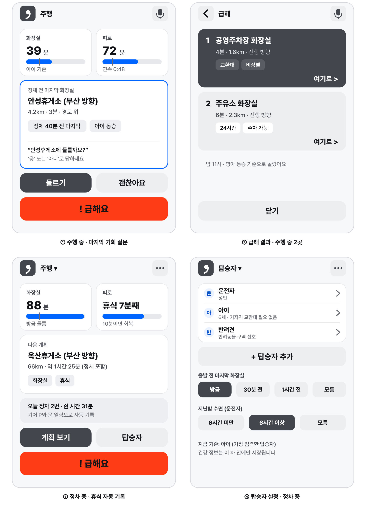

# 쉼표 — 기획서 02 앱 프로젝트 소개 / 심사 자료

> 접수양식(기획서) 02의 본문을 검토용으로 옮긴 사본이다. 제출본은 repo 루트의 `contest-application-consent.docx`이고 `python3 -I tools/plan/build_docx.py`로 다시 만든다. 내용을 고칠 때는 `tools/plan/content.py`를 고친다.

**앱명 / 프로젝트명**: 쉼표 — 사람용 주행가능시간

## 1. 앱 한 줄 소개

**차에는 연료 경고등이 있는데, 사람에게는 없다.**

**쉼표**는 차량 신호와 Pleos 내비게이션의 경로·정체 정보로 탑승자의 **‘사람용 주행가능시간’**(다음 화장실·휴식이 필요해질 때까지 남은 시간)을 계산하고, 그 시간이 바닥나기 전에 **경로 위에서 들를 곳을 먼저 묻는** 차량용 휴식 코치다.

## 2. 기획 배경

> 명절 정체 앞의 화장실 걱정, 2시간을 넘긴 연속 운전은 해마다 반복되지만 ‘언제, 어디서 쉴지’는 여전히 운전자가 머릿속으로 계산한다. 경로 위 휴게소와 정체는 내비게이션에, 정차와 운전 패턴은 차량 신호에 이미 있다. 쉼표는 이 데이터를 합쳐 쉬어야 할 때와 곳을 미리 알려 준다.

| 수치 | 내용 | 출처 |
|---|---|---|
| 71.6% | 2026 상반기 고속도로 사망자 중 졸음·주시태만 (95명 중 68명) | 한국도로공사, 2026-07 |
| 605만 대 | 2026 추석 고속도로 하루 평균 통행량, 서울→부산 최대 10시간 30분 | 국토부 등 전망, 2026-09 |
| 34.8% | 정체 중 가장 힘든 것 1위 ‘화장실에 못 가는 불안’ (일본 500명) | NEXER 설문, 2025 |
| 약 12% | 한국 성인 과민성 방광 추산. 과민성장증후군 진료 136만9천 명(2024) | 대한배뇨장애요실금학회, 심평원 |

#### 우리가 주목한 순간

| 누가 | 불편한 순간 | 근거 |
|---|---|---|
| 명절·휴가 장거리 가족 | 정체 40분 앞에서 ‘다음 휴게소까지 아이가 버틸까?’ 정체에 들어가면 되돌릴 수 없다. | 2026 추석 이동 3,093만 명, 이동의 88.4%가 승용차(SBS Biz 2026-09-20). 일부 휴게소는 남녀 변기 비율 1:1, 명절 임시 화장실 예산은 3년 새 63.6% 감소(국감 자료, MTN 2026-09-22) |
| 과민성 방광·과민성장증후군이 있는 운전자 | 매일 출퇴근길, 터널·산길처럼 화장실이 드문 구간 앞에서 불안하다. 급해서 과속하는 일도 생긴다. | 성인 약 12%가 과민성 방광으로 추산, 65세 이상 약 30%는 요절박·빈뇨 등으로 불편(코메디닷컴 2026-05-12). 화장실이 급해 시속 100km로 달리다 톨게이트에 충돌한 사례(2019, 개인 사례) |
| 아이·영아·임신부·어르신·반려견과 함께 | 탑승자마다 버틸 수 있는 시간과 필요한 시설(기저귀 교환대·수유실)이 다르다. | 0~5세 173만 명, 65세 이상 운전면허 563만 명(전체 운전자의 16.1%), 반려동물 양육 591만 가구(26.7%) |
| 2시간 넘게 혼자 운전하는 운전자 | 오후·새벽에 운전이 흐트러져도 ‘조금만 더’ 하며 휴게소를 지나친다. | 도로공사 권고: 2시간 이상 연속 운전하거나 피로하면 휴게소·졸음쉼터에서 휴식(2026-07). 졸음 관련 사고는 02·06·16시 무렵에 몰린다(Horne & Reyner, BMJ 1995) |
| 택시·버스·화물 운전자 | 도심 운행 중 갑자기 급할 때 차를 세울 수 있는 화장실을 찾기 어렵다. | 서울시는 2026-03-30부터 택시기사의 화장실 목적 공영주차장 주차 30분 무료. 광역버스 기사는 기저귀를 준비할 정도라며 노동당국에 신고(세계일보 2026-04-14). 화물차는 2시간 연속 운전 후 15분 휴게 의무 |

#### 정체가 화장실 공백을 만든다

고속도로 휴게시설(휴게소·졸음쉼터)은 최대 25km 간격으로 둔다(국토교통부 졸음쉼터 지침). 정상 소통이면 15분 남짓이지만 **시속 20km 정체에서는 같은 25km가 75분**이 된다. 정체에 들어간 뒤에는 늦다. ‘정체 전 마지막 화장실’을 미리 알려 주는 일은 경로와 정체를 아는 차 안에서만 할 수 있다.

#### 기존 서비스의 빈칸

| 서비스 | 하는 일 | 빈칸 |
|---|---|---|
| 티맵 휴게소 혼잡도·심플맵 | AI 휴게소 혼잡도, 연휴 화장실 혼잡도, 휴게소 안 화장실·수유실 위치 | 다음 화장실까지 남은 시간이나 정체 전 마지막 기회는 계산하지 않는다 |
| RestMap (미국) | 경로 위 화장실·식사·연료 정차 제안, 긴 공백 경고 | 출발 전 계획 중심. 실시간 정체, 탑승자 상태, 차량 연동이 없다 |
| 도로공사 휴식포인트 | 휴게소·졸음쉼터에서 15분 이상 쉬면 포인트 지급 | 도착한 뒤 보상한다. 언제 쉬어야 하는지는 미리 계산하지 않는다(협력 대상) |
| 순정 운전자 주의 경고(DAW) | 주행 패턴을 보고 주의 수준이 낮으면 휴식 권유 | 어디서, 언제 쉴지는 안내하지 않는다(보완 관계) |
| ABRP ‘Restroom Break’ | EV 경로 플래너. 사용자가 ‘경로 위 다음 화장실’ 기능을 요청 | 상태 ‘Planned’. 수요는 확인되지만 기능이 없다 |

확인한 범위에서 탑승자 상태로 다음 화장실까지 남은 시간을 계산하거나, 정체·터널로 생기는 화장실 공백 전에 알려 주는 차량용 제품은 찾지 못했다. 반면 공공은 이미 ‘쉬게 하는 일’에 돈을 쓴다. 도로공사 휴식 보상에는 2025년 약 62만 명이 참여해 190만여 회 쉬었고, 서울시는 택시기사 화장실 주차를 무료로 했다. 쉼표에게 공공은 경쟁자가 아니라 협력 대상이다.

#### 왜 차 안에서 풀어야 하나

| 판단에 필요한 데이터 | 차 안의 출처 | 휴대폰 앱이라면 |
|---|---|---|
| 경로 위 휴게소·졸음쉼터, 정체 구간 | Pleos 내비게이션(NaviHelper)의 회전 안내와 경로 상태 | 다른 내비 앱의 경로·정체를 읽을 수 없다 |
| 정차·휴식 여부 | 기어 P, 도어 열림 | GPS로 추정할 뿐, 문 열림은 모른다 |
| 운전 패턴 | 조향각, 브레이크, 차속 | 알 수 없다 |
| 실내 공기 | 공조 내기순환 상태와 제어 | 알 수도, 바꿀 수도 없다 |

쉼표는 이 신호로 스스로 판단하고 음성으로 한 번 묻는다. 운전자는 화면을 조작하지 않고 ‘응’ 한마디로 경유지를 넣는다.

## 3. 앱 주요 기능 및 차량 특화 요소

> 핵심은 **사람 게이지**다. 차의 주행가능거리처럼 탑승자의 다음 화장실·휴식까지 남은 시간을 보여 주고, 그 시간이 경로 앞 화장실 공백보다 짧아지면 공백 전 마지막 기회를 묻는다. 판단은 차량 신호와 Pleos 내비 데이터로 자동으로 이루어지고, 운전자는 ‘응/아니’로만 답한다.

*그림 1. 사람 게이지 — 차가 남은 연료로 갈 수 있는 거리를 보여 주듯, 탑승자 중 가장 먼저 필요해지는 사람을 기준으로 남은 시간과 이유를 보여 준다*

#### 핵심 기능 8가지와 차가 필요한 이유

| 기능 | 사용자에게 | 차량이라서 가능한 이유 · 신호와 API |
|---|---|---|
| ① 사람 게이지 2개 | 화장실·피로 게이지가 탑승자 중 가장 먼저 필요해지는 사람 기준으로 남은 분과 이유(‘아이 기준’, ‘연속 0:48’)를 보여 준다. 1~2초 안에 읽힌다. | 기어·차속으로 실제 주행 시간을 재고, 정차하면 저절로 회복된다. 사용자가 입력할 것이 없다. AAOS `GEAR_SELECTION`, `PERF_VEHICLE_SPEED` |
| ② 마지막 기회 알림 | 정체·터널·드문 구간 때문에 생기는 화장실 공백이 게이지보다 길면, 공백 전 마지막 휴게소를 진입 2~5km 전에 음성으로 묻는다. ‘응’ 하면 경유지가 된다. | 경로 위·진행 방향의 휴게소와 졸음쉼터는 내비 회전 안내(`getTBTInfo`)에서, 정체 구간은 경로 상태(`getRouteStateInfo`)에서 읽는다. 휴대폰 앱은 내비의 경로를 볼 수 없다. 수락하면 `addWaypoint` |
| ③ 급해 모드 | ‘화장실 급해’ 한마디나 큰 버튼 하나로 진행 방향·유턴 없음·주차 가능·지금 영업 중·야간 안전 시설(비상벨·CCTV)·기저귀 교환대를 따져 주행 중에는 1~2곳만 보여 준다. | 후보까지 실제 경로 거리를 `requestTrip`으로 구해 반대 방향(유턴 필요) 후보를 걸러낸다. 길안내를 방해하지 않는다. 위치·방향은 FusedLocation |
| ④ 탑승자 설정 | 성인·아이(나이)·영아·임신부·어르신·과민성 방광·과민성장증후군·반려견을 고르면 기준 시간과 필요한 시설이 바뀐다. 질환 이름은 소리 내어 말하지 않는다. | 말로 설정할 수 있고, 주행 중에는 설정 화면을 잠근다(`CarUxRestrictions` NO_SETUP). 건강 관련 정보는 차 안에만 저장 |
| ⑤ 휴식 자동 기록 | 기어 P 10분 이상은 휴식, P 3분 이상 + 문 열림은 화장실 정차로 기록해 게이지를 되돌리고 그 사람의 실제 간격을 학습한다. | 기어(`GEAR_SELECTION`)와 도어(`registerDoorPosition`) 신호. 휴대폰은 차가 섰는지, 문을 열었는지 모른다 |
| ⑥ 운전 스타일 보조 신호 | 이번 주행 초반의 나와 비교해 조향 보정·차속 변동·급제동이 늘면 휴식 제안을 앞당긴다. 내기순환이 길면 외기 전환을 권하고, 허용하면 직접 바꾼다. 졸음 판정은 하지 않는다. | 조향각·브레이크·방향지시등·크루즈 리스너(`registerSteeringWheelAngle` 등)와 차속. 공조는 `setHvacRecirculation`으로 바꾼 뒤 다시 읽어 반영을 확인 |
| ⑦ 피트스톱 플래너 | 출발 전·정차 중에 화장실·2시간 휴식·식사·주유·수유를 한 번에 묶어 정차 횟수와 시간을 줄인 계획을 만들고, 경유지로 넣는다. | 경로 앞 기회(회전 안내), 정체, 도착 시간(`requestTrip`). 정차 중에만 여는 화면(LIMIT_CONTENT) |
| ⑧ 음성 대화 | 질문은 한 번에 하나, 대답은 ‘응/아니’. ‘아이가 배 아프대’, ‘좀 쉬고 싶어’ 같은 자유 발화도 받는다. | TTS·STT를 ON_DEVICE 모드로 써서 터널처럼 네트워크가 끊겨도 동작한다. 의도 분류는 규칙 기반이 기본이고 LLM은 선택 |

#### 주행 중 화면 원칙 (주행 규제 연동)

- Manifest에 `distractionOptimized`를 선언하고, `CarUxRestrictions`가 주행 중을 알리면 화면을 ‘결정 하나’로 줄인다. 게이지 2개, 추천 1곳, 이유 칩 2개, 터치 요소 4개(들르기·괜찮아요·급해·마이크).
- 계획·탑승자·기록·설정 화면은 정차 중에만 열린다(NO_SETUP, LIMIT_CONTENT). 주행이 시작되면 주행 화면으로 돌아가고, 입력하던 값은 정차 후 복원한다.
- 주행 화면의 글자는 최소 28dp, 게이지 숫자는 60dp(17" 화면에서 글자 높이 약 3.7mm, 7.9mm). 애니메이션과 자동 스크롤은 없다. 상태는 색만으로 전하지 않고 숫자와 단계 배지를 함께 쓴다.
- 다음 회전이 500m 안이거나 최근 10초 안에 제동·큰 조향이 있으면 묻지 않는다. 거절하면 15분 동안 같은 질문을 하지 않고, 앱이 먼저 거는 질문은 시간당 4번까지다.
- 로터리 컨트롤러(CCP) 회전 순서를 화면마다 정했고, 최상위 화면의 Back은 앱을 끄지 않고 숨긴다(`moveTaskToBack`).

## 4. 주요 사용 시나리오

네 장면 모두 Pleos Connect Emulator와 Virtual Console에서 재현한다. 차량 신호(기어·차속·조향·도어·공조)는 Virtual Console 시나리오로, 위치와 정체는 앱의 시연 모드로 넣는다.

*그림 2. 장면 A — 정체 40분 앞. 아이의 화장실 게이지(39분)가 정체 뒤 첫 휴게소까지의 시간(58분)보다 짧아 안성휴게소 4km 전에 묻는다*

**A. 귀성길 마지막 화장실** · 부모 + 6세 아이 · 추석 서울→부산 · 경부고속도로

| 단계 | 차·앱이 하는 일 | 사용자가 듣고 보는 것 |
|---|---|---|
| 1. 출발 전 (정차) | 탑승자 ‘6세 아이’를 말로 설정. 피트스톱 플래너가 화장실·식사·주유를 묶은 정차 계획을 만든다 | 계획 화면: 정차 2곳 · [계획대로 경유지 넣기] |
| 2. 기흥 부근 | 내비 회전 안내에서 경로 앞 휴게소·졸음쉼터를, 경로 상태에서 정체 40분 구간을 읽는다. 아이 게이지 39분 < 정체 뒤 첫 휴게소 58분 → ‘마지막 기회’ | 화장실 게이지 39분 ‘아이 기준’ · 추천 카드 ‘안성휴게소, 정체 전 마지막’ |
| 3. 안성휴게소 4km 전 | 다음 회전이 500m 밖이고 최근 10초에 급제동·큰 조향이 없을 때 묻는다 | “앞에 40분 정체가 있어요. 안성휴게소가 정체 전 마지막 화장실이에요. 들를까요?” |
| 4. “응” | ON_DEVICE 음성 인식 → 수락 → `addWaypoint`로 가는 방향 안성휴게소를 경유지로 넣는다 | “안성휴게소를 경유지로 넣었어요.” 내비 경로에 경유지 표시 |
| 5. 휴게소 정차 | 기어 P 3분 이상 + 문 열림 → 화장실 정차로 기록. 아이의 실제 간격으로 개인 모델을 갱신 | 화장실 게이지가 다시 찬다 |

**B. 오후 졸음과 운전 패턴 변화** · 혼자 운전 · 오후 3시 · 마지막 휴식 후 1시간 35분

| 단계 | 차·앱이 하는 일 | 사용자가 듣고 보는 것 |
|---|---|---|
| 1. 오후 3시, 연속 1:35 | 연속 운전 시간에 오후 졸음 시간대 가중을 더해 피로 게이지를 계산 | 피로 게이지 ‘확인’ 단계 · 이유 ‘오후 졸음 시간대’ |
| 2. 운전이 흐트러짐 | 정속 구간의 조향 보정·반전과 차속 출렁임이 이번 주행 초반 기준선보다 커져 편차 점수가 오른다 → 피로 단계를 한 단계 앞당김 | 피로 게이지 ‘곧’ 단계 · 이유 칩 ‘운전 패턴 변화’ |
| 3. 내기순환 30분 이상 | 환기 이유 추가. 설정에서 허용했으면 외기로 바꾸고 값을 다시 읽어 확인 | “환기를 위해 외기로 바꿨어요.” |
| 4. 졸음쉼터 앞 | 이 운전자가 잘 받아들인 묻는 거리(2~5 · 5~10 · 10~20km 구간)를 톰프슨 샘플링으로 골라 묻는다 | “곧 2시간이에요. 앞 졸음쉼터에서 15분 쉬어 갈까요?” |
| 5. 편차가 계속 크면 | 상태 확인 질문. ‘졸려’라고 답하면 가장 강한 신호로 받아 가까운 쉴 곳을 바로 제안 | “괜찮으세요? 조금 졸리세요?” |

**C. 밤 11시 급해 모드** · 영아 동승 · 도심 · 길안내 없음

| 단계 | 차·앱이 하는 일 | 사용자가 듣고 보는 것 |
|---|---|---|
| 1. “화장실 급해” | 반경 5km 안 후보(공중화장실·주유소·공영주차장·졸음쉼터)를 내장 공공데이터의 격자 색인으로 추린다 | 화면이 급해 결과로 바뀐다 |
| 2. 순위 계산 | 경로 시간(`requestTrip`) + 주차·도보 + 유턴 여부로 총 소요를 구한다. 영업 종료·주차 불가는 빼고, 22~06시에는 비상벨·CCTV, 영아 동승이면 기저귀 교환대에 가점 | 주행 중이라 2곳만 · “4분, 공영주차장 화장실, 교환대·비상벨 있음” |
| 3. “응” | 길안내 중이면 경유지(`addWaypoint`), 아니면 새 경로(`requestRoute`) | “가장 빠른 곳으로 안내할게요.” 내비 안내 시작 |

**D. 쉬고 다시 출발 (휴식 자동 기록)** · 어느 장면이든 · 휴게소 정차

| 단계 | 차·앱이 하는 일 | 사용자가 듣고 보는 것 |
|---|---|---|
| 1. 기어 P | 정차 시작 시각 기록 | 피로 게이지 ‘휴식 중’ |
| 2. 문 열림 | P 3분 이상 + 문 열림 → 화장실 정차로 판정 | 화장실 게이지 ‘방금 들름’ |
| 3. 12분 뒤 기어 D | P 10분 이상 → 휴식으로 판정. 피로 게이지 초기화 | 두 게이지 모두 ‘여유’ |
| 4. 다음 주행 | 이번 간격이 개인 화장실 모델에 반영돼 다음 질문 시점이 그 사람에게 맞춰진다. 기록은 기기 안에만 | 기록 화면(정차 중): 오늘 정차와 휴식 시간 |

## 5. 개발 계획

> Pleos Connect(AAOS, API 34) 위에서 Kotlin으로 구현한다. SDK를 감싼 공통 모듈(`pleos-kit`), 안드로이드와 분리한 판단 엔진(`rest-engine`), 포그라운드 서비스·음성·화면을 맡는 앱(`app`)의 세 모듈이다. 설계의 핵심 가정(내비가 경로 위 휴게소와 정체를 주는가, 경유지가 가는 방향으로 들어가는가)은 에뮬레이터에서 먼저 확인했다.

#### 5-1. 구조와 데이터 흐름

*그림 3. 구조와 데이터 흐름 — 신호는 1초마다 엔진으로 올라가고, 결정은 음성 질문·경유지·공조 제어로 내려간다*

- **판단 엔진을 안드로이드와 분리**했다. 에뮬레이터 없이 JVM 단위 테스트로 검증하고, 정체·졸음·급해 장면을 재현 가능한 테스트로 남긴다. 앱은 1초마다 `CoachEngine.update()`를 부르고 게이지·질문·추천·공조 동작을 받는다.
- **pleos-kit이 에뮬레이터에서 찾은 SDK 함정을 감춘다.** 호출 스레드가 수 초 막힘 → SDK 전용 스레드, 내비가 앞으로 오면 Activity만 있는 앱은 얼려짐 → 포그라운드 서비스, 제어 성공 콜백 뒤에도 값이 안 바뀔 수 있음 → 다시 읽어 확인, 내비 요청을 연달아 보내면 경로가 취소됨 → 한 번에 하나씩, 명령 사이 3초.
- **동시성**: 엔진 호출은 `Mutex` 하나로 순서대로, 음성 질문은 한 번에 하나. 개인 데이터는 기기 안(`filesDir`)에만 저장한다.

#### 5-2. Pleos SDK·API 사용 계획과 에뮬레이터 확인 결과

| 영역 | 사용 API | 쉼표에서 쓰는 곳 | 에뮬레이터 확인 결과 |
|---|---|---|---|
| 내비 · 회전 안내 | `getTBTInfo` → `onTBTInfo` (`TURN_ENTER_SERVICEAREA`, `TURN_RESTAREA`) | 경로 앞 화장실 기회 목록과 경로 거리 | 휴게소·졸음쉼터가 이름과 함께 온다. 항목 거리를 누적하면 경로 거리(안성휴게소 47.1km ↔ 내비의 경유지 남은 거리 47.0km) |
| 내비 · 경로 상태 | `getRouteStateInfo` → `trafficStatus.congestionItemList`, `naviMode` · `getDestinationInfo`, `getCurrentLocationInfo` | 정체 구간(위치·길이·정체 시간), 길안내 여부, 남은 거리·시간 | 판교→부산역 경로에서 정체 26구간, 정체 시간은 초 단위. 경로 전 `SAFE_GUIDING`, 시작 후 `ROUTE_GUIDING` |
| 내비 · 경로 계산 | `requestTrip` → `onTripInfo` | 후보까지 실제 경로 거리·ETA, 진행 방향 판정 | 길안내를 방해하지 않는다. 안성휴게소 부산방향 47.5km, 서울방향(유턴) 57.1km → 경로/직선 거리 비로 반대 방향 판정 |
| 내비 · 경로 변경 | `addWaypoint`, `requestRoute`, `cancelRoute` | 수락하면 경유지 추가·길안내 | 휴게소 좌표로 넣으면 가는 방향 휴게소로 잡힌다(안성휴게소 바로 뒤 300m에 경유) |
| 차량 · 주행 | `registerSteeringWheelAngle`, `registerTurnSignalState`, `registerBrakePedalStatus`, `registerCruiseControlState` | 운전 스타일 편차, 말 걸지 않을 순간 | 조향각·방향지시등 리스너 동작, 브레이크·크루즈 조회 통과. 조향각은 Virtual Console 값과 부호가 반대라 크기와 반전 횟수만 쓴다 |
| 차량 · 도어 | `registerDoorPosition` | 화장실 정차 판정 | 도어 영역 6개, 열림·닫힘 이벤트 수신 |
| 차량 · 공조 | `registerHvacRecirculationState`, `registerHvacPowerState`, `setHvacRecirculation` | 환기 권유, 외기 전환 | 제어 후 값 변경과 변경 이벤트 확인(차량 시뮬레이터가 켜진 상태) |
| AAOS Car API | `CarPropertyManager` (`GEAR_SELECTION`, `PERF_VEHICLE_SPEED`), `CarUxRestrictionsManager` | 주행 시간, 휴식 판정, 주행 중 화면 제한 | 기어 D + 40km/h → 11.1m/s, 주행 제한 켜짐. Trip 주행 시간 API는 에뮬레이터 미지원이라 앱이 직접 잰다 |
| 음성 | TextToSpeech `speak`, SpeechToText `request` (ON_DEVICE) | 질문과 ‘응/아니’ 대답 | TTS는 재생 완료까지 확인. STT는 에뮬레이터에 마이크 입력이 없어 호출만 확인 |
| 위치 | FusedLocation `registerFusedLocationCallback`, `getLastKnownLocation` | 급해 모드 후보 검색, 진행 방향 | 수신 확인. `adb emu geo fix`는 위치 SDK만 바꾸고 내비 위치는 그대로라 시연은 앱의 시연 모드로 한다 |
| LLM (선택) | LLM SDK `generateContent` (ON_DEVICE) | 자유 발화 해석(선택 기능) | 초기화는 되지만 40초 동안 응답 없음 → 규칙 기반 의도 분류가 기본 |

확인 환경: Pleos Connect Emulator 2.1.0(API 34) + Virtual Console, Vehicle 2.3.2 · NaviHelper 3.0.5 · TextToSpeech/SpeechToText 3.3.1 · FusedLocation 1.1.3. 앱의 자체 점검(KitSelfTest)과 검증(SdkVerify) 결과는 저장소 docs/kit-selftest.md, docs/product/SPEC.md 8장에 있다.

#### 5-3. 판단 엔진 (AI·의사결정)

*그림 4. 판단 엔진 — 상태 추정 → 판단·계획 → 전달, 그리고 기기 안 학습*

| 구성 | 방법 | 근거 |
|---|---|---|
| ① 화장실 필요 모델 | 탑승자별로 ‘마지막 화장실 이후 시간’에 와이블 생존모형(형상 고정)을 두고, 척도에 켤레 사전분포를 둬 개인 정차 기록으로 닫힌 식 베이즈 갱신. 다른 사람 때문에 선 정차, 화장실 없이 도착한 회차는 중도절단으로 반영. 게이지 = 가장 먼저 필요 확률 50%에 닿는 사람의 남은 분 | 사전값은 배뇨일지 연구에서: 배뇨 불편 없는 성인의 주간 간격 약 2.2~2.9시간(1,152명 일지에서 파생), 과민성 방광 하루 11.6회. 배뇨의 65%는 요의 없이 한다 |
| ② 운전 스타일 편차 | 이번 주행 초반 정속 구간(제동·방향지시등 없음)으로 개인 기준선(중앙값·MAD)을 만들고, 60초 창마다 조향 반전율·조향 보정 크기·차속 변동·급제동의 강건 z점수를 결합해 EWMA로 지속되는 변화만 잡는다(0~1) | 운전자별 주행 초반 기준선(Friedrichs & Yang 2010), 조향 반전율 정의(Markkula & Engström 2006), EWMA 변화 감지(NIST 핸드북) |
| ③ 규칙 기반 피로 모델 | 마지막 휴식 이후 연속 운전 시간을 기본으로, 졸음 시간대(02~06시 강, 14~16시 중), 수면 부족(선택 응답), 운전 스타일 편차, ‘졸려’ 자기보고로 단계를 앞당긴다. 편차만으로 강한 경고는 내지 않는다 | 2시간마다 15분(영국 Highway Code, 국내 화물차 규정, 도로공사). 지난 24시간 수면이 4~5시간이면 사고 위험 4.3배(AAA Foundation 2016) |
| ④ 마지막 기회 | 경로 앞 화장실 기회를 경로 거리순으로 놓고, 정체 뒤 기회는 정체 시간만큼 도착을 늦춘다. 게이지 안에 닿는 마지막 기회 뒤의 공백이 게이지보다 길면 그 기회를 묻는다 | 휴게시설 간격 최대 25km → 시속 20km 정체에서 75분. 정체 구간과 시간은 내비가 준다 |
| ⑤ 급해 순위 | 총 소요 = 주행 시간 + 주차·도보 + 유턴 벌점. 영업 종료·주차 불가 제외, 영업 여부 모름 감점, 22~06시 비상벨·CCTV 가점, 영아 동승 시 기저귀 교환대 가점 | 졸음쉼터 기본시설에 여성화장실 비상벨·CCTV(국토부 지침), 공중화장실 데이터의 개방시간·교환대·비상벨 필드 |
| ⑥ 피트스톱 플래너 | 경로 순서가 고정된 정차 배치를 동적 계획법으로 푼다(상태: 마지막 정차·주유·식사 여부, O(n²)). 비용은 제약 위반 시간 → 정차 수 → 선호 → 정차·우회 시간 순. 각 정차에 목적을 묶는다 | 고정 경로 위 휴식 배치(트럭 운전자 일정 문제, Goel 2009), 경로 순서 DP(주유소 문제, Khuller 외 2007) |
| ⑦ 묻는 타이밍 | 규칙 게이트(다음 회전 직전, 제동·큰 조향 직후, 거절 직후에는 묻지 않음, 시간당 상한) 안에서 질문 종류 × 묻는 거리 구간별 수락률을 베타-베르누이 톰프슨 샘플링으로 학습 | 음성 작업 뒤 인지 분산 최대 27초(AAA 2015). 성가신 경고는 꺼진다: 차로이탈경고 켜짐 32.8%(Reagan & McCartt 2016) |
| ⑧ 음성 의도 | 규칙 기반 한국어 의도 분류(부정 먼저, 탑승자·목적 추출)가 기본. LLM을 쓸 때도 발화를 정해진 도구 호출(JSON)로 바꾸기만 하고 정차 결정은 결정적 플래너가 한다. 3초 안에 답이 없으면 규칙으로 | Pleos LLM SDK는 텍스트 입출력만 있고 함수 호출 API가 없다. 에뮬레이터 ON_DEVICE 무응답 확인 |

> **주장하지 않는 것**
>
> - **졸음을 감지한다고 말하지 않는다.** 카메라 없이 조향만으로는 근거가 약하다. EU 졸음경고장치 인증 기준도 평균 민감도 40% 초과이고, 차선 카메라까지 쓴 실도로 연구에서도 졸음 정분류는 54.6%였다. 운전 스타일은 보조 신호이며 순정 운전자 주의 경고를 보완한다.
> - **의료 진단이나 질환 관리 효과를 주장하지 않는다.** 게이지는 시간·탑승자 유형·정차 기록으로 계산한 ‘권유 시점’이고, 근거를 화면과 음성으로 함께 보여 준다. 휴게소 혼잡도나 정체 해소 시점도 예측하지 않는다.
> - **건강 관련 탑승자 정보와 정차 기록은 기기 밖으로 보내지 않는다.** 원시 조향·속도 값은 판정용 이동 창에만 둔다.

#### 5-4. 데이터와 라이선스

| 데이터 | 출처 | 쓰는 곳 | 이용 조건 |
|---|---|---|---|
| 고속도로 휴게소 | 공공데이터포털 전국휴게소정보표준데이터(한국도로공사) | 마지막 기회, 플래너(편의시설) | 공공데이터, 출처 표시 |
| 졸음쉼터 253곳 (모두 화장실 있음) | 공공데이터포털 전국졸음쉼터표준데이터(한국도로공사, 2026-02 기준) | 마지막 기회, 급해 모드 | 공공데이터, 출처 표시 |
| 공중화장실 (개방시간·교환대·비상벨·CCTV) | 지방행정 인허가 데이터(LOCALDATA). 2025-02부터 좌표가 빠져 다른 공공 인허가 데이터의 주소·좌표로 직접 지오코딩 | 급해 모드 | 공공데이터, 출처 표시 |
| 주유소·공영주차장·비상벨·CCTV | LOCALDATA, 전국주차장정보표준데이터, OpenStreetMap | 급해 모드(주차 가능 여부) | 공공데이터 / OSM은 ODbL 1.0 |
| 휴게소 진행 방향 | OpenStreetMap 고속도로 차로 형상(우측 통행 기준으로 방향 판정) | 반대 방향 휴게소 제외 | ODbL 1.0, © OpenStreetMap contributors |
| 정체·경로·도착 시간 | Pleos NaviHelper(실시간) | 마지막 기회, 플래너, 급해 모드 | Pleos SDK |
| 개인 데이터 (탑승자, 정차 기록, 학습 상태) | 기기 안(앱 내부 저장소) | 개인 모델 | 기기 밖으로 보내지 않음 |

아이콘은 Material Symbols(Apache 2.0)를 쓴다. 데이터·아이콘 출처와 라이선스는 앱의 설정 > ‘데이터 출처와 라이선스’에 표기한다.

#### 5-5. 개발 현황

| 완료 | 남은 일 |
|---|---|
| SDK 검증 앱으로 각 SDK 호출과 함정(호출 스레드 블로킹, 앱 얼림, 제어 미반영, 내비 요청 간격) 확인 | 주행·계획·급해·탑승자·기록·설정 화면 완성(Pleos UI 가이드, CCP 포커스) |
| 공통 모듈 pleos-kit: 5개 SDK와 AAOS Car API 래퍼, 에뮬레이터 자체 점검(KitSelfTest) | 엔진 시나리오 단위 테스트 확대(정체·졸음·급해 재현), 기본값을 연구 근거 값으로 정리 |
| 설계 가정 검증(SdkVerify): 정체 목록, 회전 안내의 휴게소·졸음쉼터, `requestTrip` 방향 판정, 휴게소 경유지 추가, 조향각·방향지시등, LLM ON_DEVICE | 오프라인 장소 데이터 정제와 앱 탑재, 출처 표기 화면 |
| 판단 엔진 rest-engine: 7개 구성 요소(화장실 필요, 운전 스타일, 피로, 마지막 기회, 급해 순위, 피트스톱, 묻는 타이밍) 구현, 안드로이드 의존 없는 순수 Kotlin | 실제 음성 인식 확인(에뮬레이터는 마이크 입력이 없어 STT는 호출만 확인) |
| 앱: 포그라운드 서비스, 신호 수집, 회전 안내 → 화장실 기회 변환, 정체 위치 계산, 경로 거리 조회, 음성 의도 분류, 시연 모드, Pleos 디자인 토큰 테마 | 시연 영상, release APK, GitHub README |
| 오프라인 장소 데이터 수집·지오코딩 도구, Virtual Console 시연 시나리오 3종 | 2차 PT까지: 질문 문구와 시점 다듬기, 사용성 점검 |

## 6. 기대효과 및 발전 가능성

> 사람 게이지는 매일 통근(과민성 방광·과민성장증후군), 주말 나들이(아이·반려견), 명절 장거리(가족)에 모두 쓰이는 반복 수요다. 기본 시나리오에서 2030년 국내 MAU 약 3.9만, 명절이 있는 달 약 7.7만으로 추정한다. B2C는 입구이고, 매출 축은 운전자 환영 화장실 네트워크·운수사·공공 협력(B2B·B2G)이다.

#### 6-1. 사용자 가치

| 대상 | 가치 |
|---|---|
| 운전자 | 화장실·휴식을 ‘버티기’에서 ‘계획’으로 바꾼다. 2시간 휴식 권고를 실제 정차로 잇고, 정체 속 비상 상황과 급한 과속을 줄인다. |
| 동승 가족 | 아이·어르신·임신부·반려견 기준으로 미리 쉬어 간다. 기저귀 교환대·수유실이 있는 곳을 고른다. |
| 직업 운전자 | 진행 방향·주차 가능·지금 열린 화장실을 한 번에 찾는다. 화장실 걱정에 물을 덜 마시는 일을 줄인다. |
| 공공·플랫폼 | 휴식 유도와 휴게소 수요 분산에 쓸 익명·집계 데이터. Pleos 앱마켓이 찾는 ‘차량이라서 더 유용해지는 앱’의 사례. |

#### 6-2. 타깃 고객

| 세그먼트 | 규모 | 쓰는 순간 |
|---|---|---|
| 명절·휴가 장거리 가족 | 2026 추석 이동 3,093만 명(인구의 약 60%). 국내여행 연 3억90만 회, 자가용 84.5% | 명절·휴가철, 주말 장거리 |
| 과민성 방광·과민성장증후군 | 성인 약 12% 추산, 과민성장증후군 진료 136만9천 명(2024) | 매일 통근(하루 평균 73.9분) |
| 영유아·아동 동승 | 0~5세 173만4천 명, 아동(0~17세) 664만 명 | 주말 나들이, 장거리 |
| 고령 운전자·동승자 | 65세 이상 운전면허 563만 명(전체 운전자의 16.1%) | 상시 |
| 반려동물 가구 | 591만 가구(전체의 26.7%) | 주말 나들이, 여행 |
| 직업 운전자 (B2B) | 사업용 운수종사자 83만1,663명, 그중 택시 약 23.7만 명 | 매일 |

#### 6-3. 예상 MAU

*그림 5. 2030년 기본 시나리오 MAU 퍼널 — 막대 길이는 국내 탑재 차량 대비 비율*

- **탑재 차량**: 그룹 국내 판매 125만8,730대(2025)가 유지되고, 신차·부분변경에 따라 탑재 비중이 40%(2027) → 65% → 85% → 95%(2030)로 오른다고 가정하면 2030년 누적 약 367만 대. 교차 확인: 글로벌 2,000만 대 계획 × 국내 판매 비중 17.3% ≈ 346만 대(차이 6%).
- **A 앱마켓 이용률 30%**: 공개 자료가 없어 가장 불확실하다. 42dot 자료로 검증해야 한다.
- **B 설치율 10%**: 수요층이 넓고(65세 이상 면허 16.1%, 반려 가구 26.7%, 성인 과민성 방광 12%), 앱마켓 앱이 18종(2026-09)이라 노출 경쟁이 적다.
- **C 월 사용률 35%**: 휴식 보상 참여자 연 3.06회 → 월 1회 이상 22.5%, 국내여행 연 6.5회 → 41.8%. 매일 수요가 있는 층을 더해 35%.

| 시나리오 | A × B × C | 2027 | 2028 | 2029 | 2030 |
|---|---:|---:|---:|---:|---:|
| 보수 | 0.25% | 1,467 | 3,512 | 6,187 | 9,177 |
| 기본 | 1.05% | 6,161 | 14,752 | 25,986 | 38,542 |
| 낙관 (기본 탑재·도로공사 연계) | 5.0% | 29,339 | 70,247 | 123,743 | 183,533 |
| 기본, 명절이 있는 달 (C 70%) | 2.1% | 12,322 | 29,504 | 51,972 | 77,084 |

누적 탑재 추정: 2027 58.7만 · 2028 140.5만 · 2029 247.5만 · 2030 367.1만 대. 같은 퍼널을 글로벌 2,000만 대에 적용하면 약 21만 MAU(나라별 화장실 데이터 확보가 전제).

#### 6-4. 리텐션 (목표, 가정)

| 지표 | 목표 | 근거 |
|---|:---:|---|
| M1 / M3 / M6 리텐션 | 40% / 30% / 25% | 반복 수요 프로필(과민성 방광·과민성장증후군·영유아·임신·반려), 하루 통근 73.9분 |
| 60분 이상 주행에서 다시 쓰는 비율 | 60% | 1인당 연 6.5회 국내여행, 약 8주에 한 번 장거리 |
| 명절 복귀율 (직전 3개월 미사용자) | 50% | 추석 이동 3,093만 명 |

리텐션 수단: 탑승자 프로필 기반 통근 알림, 명절 전 피트스톱 계획, 도로공사 휴식 보상 연계, 가족 공유, 급해 모드에서 성공한 경험을 다음 경로에 반영.

#### 6-5. 사업 모델

| 모델 | 고객 | 과금 (가정) | 근거 |
|---|---|---|---|
| B2C 프리미엄 (탑승자 프로필·급해 모드·피트스톱 플래너. 기본 게이지와 마지막 기회는 무료) | 영유아·고령·임신·과민성 방광·반려 가구 | 월 2,900원 | 6-2의 타깃 규모 |
| 운전자 환영 화장실 (B2B) | 주유소·편의점·카페 | 등재비 월 2만 원/곳 | 택시기사가 쓸 수 있는 공중화장실은 사실상 주유소뿐이라는 보도(2016). 독일 Nette Toilette: 가게에 월 60~100유로 보상, 400곳 이상 지자체 참여 |
| 개방화장실 운영 플랫폼 (B2G) | 지자체 | 연 2,000만 원/지자체 | 성동구 일부 개방화장실에 관리운영비 월 10만 원, 서울시 개방화장실 조례 |
| 휴식 유도 협력 (B2G) | 한국도로공사 | 성과형 또는 공동 캠페인 | 2025년 휴식 보상 포인트 1.8억 원(회당 약 95원). 도로공사는 휴게소 혼잡도를 이미 민간 내비에 제공 |
| 운수사 (B2B) | 택시·버스·화물 회사 | 차량당 월 3,000원 | 화물차 2시간 연속 운전 후 15분 휴게 의무, 사업용 운수종사자 83.2만 명 |
| 보험 연계 (B2B) | 손해보험사 | 제휴 수수료 | 카카오내비 안전점수 보험 할인과 같은 구조 |
| 휴게소 수요 데이터 (B2B·B2G) | 도로공사·휴게소 운영사 | 연 500만 원/곳 | 도로공사에는 화장실 이용 인원 계측 시스템이 없다(국감). 휴게소 207곳. 익명·집계 데이터만 |

2030년 기본 시나리오 매출 예시(단가는 가정): B2C 약 0.67억 원 + 화장실 네트워크 2.4억(1,000곳) + 지자체 2.0억(10곳) + 운수사 약 3.0억(종사자의 1%) + 수요 데이터 1.5억(30곳) = **약 9.6억 원**. B2C만으로는 작다. B2C는 데이터와 네트워크 효과를 만드는 입구이고, 매출 축은 B2B·B2G다.

#### 6-6. 확장 계획

| 1단계 · 앱마켓 출시 | 2단계 · 네트워크 | 3단계 · 데이터와 확장 |
|---|---|---|
| 국내 고속도로·휴게소·졸음쉼터 중심 B2C. 사람 게이지, 마지막 기회, 급해 모드, 탑승자 프로필. 사용 기록으로 사전값과 문턱을 보정 | 운전자 환영 화장실(주유소·편의점·카페 제휴, Nette Toilette 방식), 운수사 B2B(휴게 의무 관리), 도로공사 휴식 보상 연계 | 익명 정차 시간으로 휴게소 수요 분석(B2G), 연합 학습으로 집단 사전값 개선, EV 충전 정차와 휴식 묶기(`requestTrip`의 도착 예상 SOC), 해외(Pleos 2030년 약 2,000만 대 계획) |

## 7. 참고자료

| 자료 | 내용 | 위치 |
|---|---|---|
| GitHub 저장소 | 전체 소스(app, pleos-kit, rest-engine, tools), README(앱 이름·한 줄 소개, 실행 방법, 테스트 환경과 필요한 설정, APK 위치), 구조 문서(docs/ARCHITECTURE.md), 에뮬레이터 점검 결과, 근거 자료(docs/research) | **GitHub 저장소 링크: 제출 전에 계정명이 드러나지 않는 주소로 기입** |
| APK | 실행 가능한 release 빌드. 공모전 규칙에 따라 저장소 `apk/` 폴더에 두고, 용량을 넘으면 GitHub Releases | 저장소 `apk/` 폴더 |
| 시연 영상 | Pleos Connect Emulator + Virtual Console 화면 녹화로 4번 항목의 네 장면(제작 예정) | **시연 영상 링크: 제출 시 기입** |
| 화면 시안 | 주행(질문 중), 급해 결과, 정차 중 휴식 기록, 탑승자 설정(그림 6) | 이 문서 |
| 테스트 환경 | Pleos Connect Emulator 2.1.0(API 34, Automotive) + Virtual Console. Vehicle 2.3.2, NaviHelper 3.0.5, TextToSpeech·SpeechToText 3.3.1, FusedLocation 1.1.3 | README |

*그림 6. 화면 시안 (Pleos Connect 세로 윈도 840×1184dp, 라이트 테마)*

#### 주요 출처

| # | 내용 | 출처 (날짜) | URL |
|:---:|---|---|---|
| 1 | 고속도로 졸음·주시태만 사망, 휴식 보상 실적 | 파이낸셜뉴스, 한국도로공사 (2026-07-28) | fnnews.com/news/202607281338101369 |
| 2 | 2시간 이상 연속 운전 시 휴식 권고 | 파이낸셜뉴스 (2026-07-07) | fnnews.com/news/202607071051189361 |
| 3 | 2026 추석 교통 전망 | SBS Biz (2026-09-20) | biz.sbs.co.kr/amp/article/20000335726 |
| 4 | 정체 중 화장실 불안 설문(일본) | 리세맘, NEXER (2025-06-04) | resemom.jp/release/prtimes/20250604/146590.html |
| 5 | 휴게소 화장실·임시 화장실 예산(국감) | MTN (2026-09-22) | news.mtn.co.kr/news-detail/2026092210062671869 |
| 6 | 과민성 방광 유병 | 코메디닷컴 (2026-05-12) | kormedi.com/2815262 |
| 7 | 과민성장증후군 진료 인원 | 경향신문, 심평원 (2025-09-06) | v.daum.net/v/20250906090223945 |
| 8 | 택시·버스 기사 화장실 | 세계일보 (2026-04-14) | segye.com/newsView/20260414515972 |
| 9 | Pleos Connect 2030년 약 2,000만 대 | 현대자동차그룹 (2026-04-30) | hyundaimotorgroup.com/ko/news/hyundai-motor-group-redefines-in-vehicle-experience-with-pleos-connect-next-generation-infotainment-system |
| 10 | 앱마켓 앱 18종 | 오토뷰 (2026-09-07) | autoview.co.kr/ko-kr/articles/101647 |
| 11 | 65세 이상 운전면허 | 매일신문 (2026-09-16) | imaeil.com/page/view/2026091609325782088 |
| 12 | 반려동물 가구 | 한국경제 (2025-07-08) | hankyung.com/article/202507048993g |
| 13 | 국내여행 자가용 비중 | 경기일보 (2026-06-30) | kyeonggi.com/article/20260630580100 |
| 14 | 사업용 운수종사자 | SBS Biz (2026-10-02) | biz.sbs.co.kr/amp/article/20000337975 |
| 15 | 졸음쉼터 표준데이터 | 공공데이터포털 | data.go.kr/data/15028203/standard.do |
| 16 | 수면 부족과 사고 위험 | AAA Foundation (2016) | aaafoundation.org/acute-sleep-deprivation-risk-motor-vehicle-crash-involvement |
| 17 | 졸음 사고 시간대 | Horne & Reyner, BMJ (1995) | pmc.ncbi.nlm.nih.gov/articles/PMC2548939 |
| 18 | 배뇨일지(성인 1,152명) | van Haarst 외, BJU Int (2004) | doi.org/10.1111/j.1464-4096.2004.04821.x |
| 19 | EU 졸음경고장치 규정 | EU 2021/1341 | eur-lex.europa.eu/eli/reg_del/2021/1341/oj/eng |
| 20 | 경쟁 서비스(RestMap) | App Store | apps.apple.com/au/app/restmap/id6756338728 |

전체 출처와 검증 기록(판정, 계산 근거)은 저장소 docs/research/evidence-market.md, docs/research/ai-science.md에 있다.

## 8. 숏폼 링크

제출하지 않음
